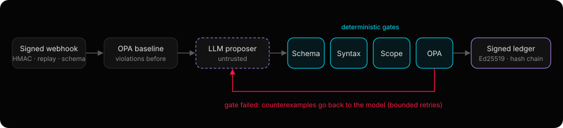

# IaC Guardian

A self-healing CI/CD security agent for Terraform and Kubernetes pull requests.

An LLM reads the infrastructure code in a pull request, reports misconfigurations and proposes a patch. The patch is **never trusted**. It only ships if four deterministic gates agree, the last of which is an Open Policy Agent policy compiled to WebAssembly. When a gate fails, its findings are sent back to the model as counterexamples and it tries again. If it cannot converge, the agent fails closed and asks for a human.

Every verdict is written to a signed, hash-chained ledger so the result can be checked later without trusting the UI.



## Why I built it this way

LLMs are good at reading a Terraform file and guessing what is wrong. They are also wrong in ways that are hard to see: they miss issues that span two resources, they claim a fix that fixes nothing, and they follow instructions hidden in the code they are reviewing. Letting that output open pull requests on its own is how a security tool becomes an attack surface.

So the design splits the job in two:

| Role | Component | Trust |
| --- | --- | --- |
| Proposer | LLM (mocked here) | None. Output is treated as attacker-controlled input. |
| Verifier | OPA policy (Wasm) + scope guard | Full. Deterministic, version-pinned, unit-tested. |

The model can be as creative as it wants. It just cannot mark its own homework.

## System architecture

```mermaid
flowchart LR
    GH[GitHub<br/>pull_request webhook] -->|HMAC-SHA256| WH[Express listener<br/>signature · replay · schema]
    WH --> Q[Job queue]
    Q --> P[HCL / YAML parser]
    P --> B[OPA baseline<br/>violations before]
    B --> L{{LLM proposer}}
    L --> G1[1 Schema gate]
    G1 --> G2[2 Syntax gate]
    G2 --> G3[3 Scope gate]
    G3 --> G4[4 OPA policy gate<br/>violations after = 0]
    G4 -->|pass| PR[Fix PR via GitHub REST]
    G4 -->|fail: counterexamples| L
    G3 -->|fail: counterexamples| L
    G4 -->|attempts exhausted| HR[Comment: human review]
    PR --> LD[(Signed ledger<br/>Ed25519 + hash chain)]
    HR --> LD
    LD --> UI[Audit report UI]
```



### The four gates

1. **Schema** – the model's reply must match a strict zod schema and may only patch files that are part of the pull request.
2. **Syntax** – the patched files must parse with HashiCorp's HCL parser (compiled to wasm) or as YAML.
3. **Scope** – a structural diff of the parsed documents. The patch may only modify resources a finding points at. It may not delete resources, add resources (one allow-listed hardening type aside), add `provisioner`/`connection` blocks, touch modules, providers, variables, outputs or backend settings, or change container images.
4. **Policy** – the patched document is evaluated by the OPA Wasm module. Acceptance requires zero violations.

Gate 3 exists because gate 4 is not enough. A patch that deletes the offending bucket is perfectly compliant. So is one that fixes the bucket and also adds a `local-exec` provisioner. OPA answers "is this compliant?"; the scope guard answers "did the patch do anything it had no reason to do?".

### Repair loop

The first prompt contains only the code. If a gate rejects the patch, the next prompt also contains the remaining OPA violations and scope errors. This is the same idea as counterexample-guided synthesis: the verifier does not just say no, it says why. The loop is bounded (`MAX_REPAIR_ATTEMPTS`, default 3).

### Policy as a pinned artifact

`policy/rego/*.rego` is compiled to `policy/dist/policy.wasm` by `npm run policy:build`, which also writes a manifest with the module's SHA-256 and the hash of each source file. At startup the agent recomputes the digest and refuses to run if it does not match. A test also checks that the committed wasm was built from the committed Rego, so the two cannot drift apart silently. The digest is included in every signed verdict.

### Attestation ledger

Each audit appends an [in-toto](https://in-toto.io/) style statement to an append-only ledger: file digests before and after, the policy digest, the result of every gate on every attempt, and the verdict. Each entry includes the hash of the previous entry and is signed with Ed25519. Editing or removing a past verdict breaks the chain, and re-hashing a forged entry fails signature verification. The "Verify" button in the UI recomputes all of this on the server.

## Policy coverage

| Rule | Severity | What it catches |
| --- | --- | --- |
| TF001 | critical | S3 bucket with a public canned ACL |
| TF002 | high | S3 bucket not covered by a complete public access block *(cross-resource)* |
| TF003 | critical | SSH/RDP open to `0.0.0.0/0` or `::/0`, including port ranges and protocol `-1` |
| TF004 | high | IAM statement allowing wildcard actions on `*` |
| TF005 | critical | RDS instance with a public endpoint |
| TF006 | high | RDS storage not encrypted |
| TF007 | high | EC2 instance that does not enforce IMDSv2 |
| TF008 | medium | Unencrypted EBS volume |
| TF009 | critical | Database reachable from the internet through an attached security group *(cross-resource)* |
| K8S001 | critical | Privileged container |
| K8S002 | high | Container may run as root |
| K8S003 | high | Pod shares a host namespace |
| K8S004 | medium | `allowPrivilegeEscalation` not disabled |

TF002 and TF009 are the interesting ones. In TF009 the database and the security group each look acceptable on their own; the flaw is the path between them. These are also the two findings the mocked model misses on its first pass.

## Threat model

| Threat | Mitigation |
| --- | --- |
| Forged webhook triggers the pipeline | HMAC-SHA256 over the raw body, constant-time comparison, secret must be ≥ 32 chars, process will not start without one |
| Captured webhook is replayed | Bounded delivery-ID cache rejects duplicates |
| Path traversal / API path injection via payload fields | Strict allow-list regexes on owner, repo, ref, SHA and file paths; values are still URL-encoded at the call site |
| Oversized or malformed payloads (DoS) | 1 MB body limit, 20 files, 200 KB per file, rate limiting, request timeouts, capped wasm memory |
| Prompt injection in reviewed code | Per-request random delimiters around untrusted files; scope gate rejects anything the findings do not justify |
| Model "fixes" by deleting or weakening resources | Scope gate: no deletions, no out-of-scope edits |
| Model adds a backdoor alongside a real fix | Scope gate: no new resources, provisioners, modules, providers, outputs; images are immutable |
| Model claims success without fixing anything | Policy gate evaluates the result; the model's summary is never consulted |
| Policy module swapped on disk | SHA-256 pinned in manifest, verified at load, digest embedded in signed verdicts |
| Audit record edited after the fact | Hash-chained, Ed25519-signed ledger |
| XSS in the report UI (it renders attacker-written code) | React escaping plus a CSP with `default-src 'none'`, no inline script or style, no third-party origins, self-hosted fonts |
| Token leakage | Token only read from the environment, never logged, upstream error bodies are not propagated, redirects are refused |
| Agent pushes to a protected branch | It only ever opens a PR into the contributor's branch; a human merges |

Out of scope: a compromised GitHub account, a malicious policy author, and the correctness of the LLM itself (which is the point).

## Running it

Requires Node.js 20 or newer.

```bash
npm install
npm run build      # builds the report UI into web/dist
npm run demo       # starts the agent in demo mode on http://127.0.0.1:8787
```

Demo mode generates a random webhook secret, uses a dry-run GitHub client and shows five scenario buttons in the UI:

| Scenario | What happens |
| --- | --- |
| Exposed payments stack | 8 violations. Attempt 1 misses the two cross-resource ones, OPA reports them, attempt 2 is accepted. |
| Privileged Kubernetes workload | 4 violations fixed and verified on the first attempt. |
| Prompt injection in a comment | The model obeys a comment and appends a `local-exec` backdoor. The scope gate blocks it; the next attempt is clean. |
| Wildcard IAM policy | The model keeps proposing narrower wildcards. Rejected after 3 attempts, no PR is opened. |
| Compliant change | Passes as submitted. |

### Against a real repository

```bash
cp .env.example .env    # set WEBHOOK_SECRET and GITHUB_TOKEN
node --env-file=.env src/server.js
```

Point a GitHub webhook (content type `application/json`, event "Pull requests") at `/webhook`. With a token configured the agent fetches the changed `.tf`/`.yaml` files itself, opens the fix PR through the Git data API as a single commit, and sets a `iac-guardian/policy-gate` commit status.

To send a signed webhook by hand:

```bash
WEBHOOK_SECRET=... npm run simulate -- payments
```

### Changing the policy

Install the [OPA CLI](https://www.openpolicyagent.org/docs/#running-opa), edit `policy/rego/`, then:

```bash
npm run policy:test    # 27 Rego unit tests
npm run policy:build   # recompiles policy.wasm and updates the manifest
```

## Tests

```bash
npm test            # 69 Jest tests: webhook auth, validation, gates, ledger, GitHub client
npm run test:e2e    # 8 Playwright tests against the built UI (run `npm run build` first)
npm run policy:test # 27 OPA tests (needs the opa CLI)
```

The pipeline tests include a set of deliberately hostile model replies (delete the resource, edit an unrelated one, add an output, add a module, attach a provisioner, swap an image, return invalid HCL, patch a file outside the PR, return garbage) and assert that each one is rejected by the expected gate.

## Project layout

```
src/
  app.js                 Express app: webhook, read-only API, static UI, headers
  security/              HMAC verification, replay cache, payload schema
  iac/                   HCL + YAML parsing, format-preserving HCL editor
  llm/                   Prompt builder, reply schema, mocked model
  policy/engine.js       Loads and digest-checks the OPA Wasm module
  pipeline/              Repair loop and scope guard
  attest/ledger.js       Ed25519 signer and hash-chained ledger
  github/client.js       REST client and dry-run recorder
policy/rego/             Rego sources and tests
policy/dist/             Compiled wasm + manifest
web/                     React + Tailwind report UI
fixtures/                Demo pull requests
tests/, e2e/             Jest and Playwright suites
```

## Limitations

- The LLM is mocked. `src/llm/mock.js` is a deterministic stand-in with three built-in failure modes so the gates have something to catch. Plugging in a hosted model means implementing one method (`review`); nothing downstream changes because nothing downstream trusts it.
- Terraform is analysed statically per pull request. Variables are not resolved, so `cidr_blocks = [var.anywhere]` is not flagged. Evaluating `terraform show -json` plan output would close that gap.
- Audits and the ledger are held in memory. A real deployment would persist the ledger and anchor its head hash somewhere external.
- The fix PR targets the contributor's branch, which only works for branches in the same repository, not forks.

## Real-world relevance

Misconfiguration is consistently one of the top causes of cloud breaches, and most of it is visible in the IaC before it is ever deployed. Teams are now wiring LLMs into CI to fix it automatically, which moves the problem: the question stops being "can the model write a fix?" and becomes "what stops a wrong or manipulated fix from merging?". This project is my answer to the second question. The pattern (untrusted generator, deterministic verifier, signed evidence) applies to any place an LLM is allowed to change production configuration.
